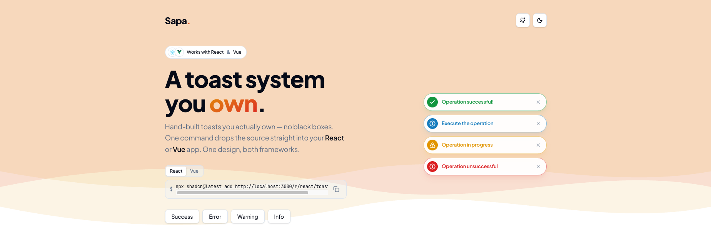

# Sapa.

A component registry for a custom-built toast. You install it into React or Vue with one command, and the code lives in your project from then on.

_Copy, paste, own it. Same design, two frameworks._



---

## Features

- One registry with two hand-written sources, `.tsx` for React and `.vue` for Vue.
- Built from scratch on framework primitives. It does not wrap `sonner` or `vue-sonner`.
- Semantic colors for success, error, warning and info, in three variants: `solid`, `minimal` (the default) and `subtle`.
- Each toast pops in as a pill with its icon and title, then grows into a card to show the description and actions. The springs come from [Motion](https://motion.dev) (`motion` for React, `motion-v` for Vue).
- Toasts leave toward the edge they are anchored to. Swipe to dismiss: sideways for corner positions, up or down for centered ones.
- Examples for the default toast, types, description, action, promise, progress, custom content and positions.
- Light and dark themes through CSS variables.
- `aria-live` announcements, a dismiss button you can reach with the keyboard, and support for `prefers-reduced-motion`.

## Install into your project

The registry is served as JSON, so the shadcn CLI can install it:

```bash
# React
npx shadcn@latest add https://sapa-registry.vercel.app/r/react/toaster.json

# Vue
npx shadcn-vue@latest add https://sapa-registry.vercel.app/r/vue/toaster.json
```

The files land in `components/ui/sapa-toast/`. The demo examples are optional:
`.../r/react/toast-types.json`, `toast-promise.json`, `toast-positions.json`, …

Mount the toaster once and call the API from anywhere:

```tsx
// React — e.g. app/layout.tsx
import { Toaster, toast } from "@/components/ui/sapa-toast/toaster";

// <Toaster position="bottom-right" />
toast.success("Saved", { description: "All changes stored." });
```

```vue
<!-- Vue — e.g. App.vue -->
<script setup>
import Toaster from "@/components/ui/sapa-toast/Toaster.vue";
import { toast } from "@/components/ui/sapa-toast/useToast";
</script>

<template>
  <Toaster position="bottom-right" />
</template>
<!-- toast.success("Saved", { description: "All changes stored." }) -->
```

## Toast API (the same in both frameworks)

`toast(msg, opts)` · `toast.success / error / warning / info(msg, opts)` ·
`toast.loading` · `toast.progress(msg, { value })` ·
`toast.promise(p, { loading, success, error })` ·
`toast.custom(node/component)` · `toast.dismiss(id?)`

Options: `title`, `description`, `duration` (`Infinity` to persist), `position`, `variant`,
`action`, `cancel`, `icon`, `progress` (0–100).

Every toast is the same bubble, and there is no `size` option. It appears as a
pill with the icon and title, then after about 450 ms (or as soon as you hover)
opens into a card for the description, actions and progress bar. A title-only
toast stays a pill. `type` picks a color from the `--sapa-*` tokens and puts it
on the round icon tile and the thin countdown ring around it, or on the
determinate fill when you pass `progress`. `variant` decides how much of the
bubble that color covers. Set it per toast or as a `<Toaster variant>` default:

- `minimal` _(default)_: a neutral glass surface, with color only on the icon and ring.
- `subtle`: the whole bubble gets a light, opaque tint of the type's color. It suits light, dense interfaces.
- `solid`: the bubble is filled with the color, and the text, icon and buttons switch to its foreground.

`<Toaster>` takes `position`, `expand` and `variant`.

## Repository layout

```
sapa/
├── registry.json              # source of truth — every item (React + Vue)
├── registry/
│   ├── theme/globals.css      # shared design tokens (framework-agnostic)
│   ├── react/                 # .tsx toast: store + <Toaster/> + <Toast/> + examples
│   └── vue/                   # .vue toast: reactive store + Toaster/Toast + examples
├── scripts/build-registry.mjs # inlines files → apps/registry/public/r/*.json
└── apps/
    ├── registry/              # Next.js showcase (live React preview, code + CLI copy)
    └── vue-sandbox/           # Vite + Vue app to verify the .vue items render
```

## Develop

```bash
pnpm install
pnpm dev            # Next.js showcase → http://localhost:3000  (auto-runs registry:build)
pnpm sandbox        # Vue sandbox      → http://localhost:5174
pnpm registry:build # regenerate apps/registry/public/r/*.json
```

## Changelog

Each release lists the files it changed: [CHANGELOG.md](CHANGELOG.md) ·
[sapa-registry.vercel.app/changelog](https://sapa-registry.vercel.app/changelog)

Sapa is copy-paste, so updating means re-copying the files each entry names.

## License

MIT © Muhamad Putra Satria
